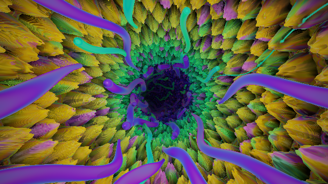

# Glimpse Before Death

The camera flies down a raymarched tunnel that twists and turns at random. The walls cycle through three looks:

- pitted clay
- fuzzy coral
- wet, heartbeat-pulsing flesh

Veins grow, writhe and respawn along the walls. An oil-slick thin-film sheen and a slow hue drift cover everything.

## Audio

| Input | Effect |
|---|---|
| Bass (`syn_BassLevel`, `syn_BassTime`) | Camera surges, veins thicken and glow, tunnel squeezes, flesh heartbeat |
| Highs (`syn_HighLevel`) | Sparkle, mostly on the coral tips |

`audio_react` scales all of it.

## Controls

| Control | What it does |
|---|---|
| `speed` | Forward flight speed |
| `twist` | How hard the tunnel bends (0 = straight) |
| `tunnel_radius` | Tunnel width |
| `vein_density` | Number of veins around the wall |
| `vein_growth_speed` | How fast veins grow, shrink and respawn |
| `sheen` | Strength of the oil-slick film |
| `hue_drift` | Speed of the palette's hue rotation (0 = fixed colors) |
| `hue_shift` | Manual hue offset |
| `audio_react` | How much audio drives the scene |

## Performance

The raymarch renders into a 960×540 buffer (`tunnelBuf`, the first pass). The final pass upscales it with a light sharpen. On an M1 Pro at 1080p output this runs at roughly 80–95 fps in Chrome.

To trade quality for speed, change `WIDTH`/`HEIGHT` under `PASSES` in `scene.json`. For example, 1280×720 is sharper and 640×360 is faster.

## Editing

1. Edit `GlimpseBeforeDeath.synScene/main.glsl`. It is the single source of truth.
2. Run `python3 build_preview.py` to inline the shader and controls into `preview.html`.
3. Refresh `preview.html` in the browser.
4. Copy the `.synScene` folder into Synesthesia.

Preview URL options:

| Option | Effect |
|---|---|
| `?t=38` | Freeze time at 38 s |
| `?speed=2` (any control name) | Override that control |
| `?buf=full` | Render the tunnel at full resolution, to compare |
| `?bench=30` | Time 30 frames and show ms/frame in the tab title |
| `?ui=0` | Hide the panel |

Keys: H toggles the panel, Space pauses.

## Versions

- **v1.0**: the first release, with the three looks, growing veins, oil-slick sheen, audio reactivity and half-res rendering.
